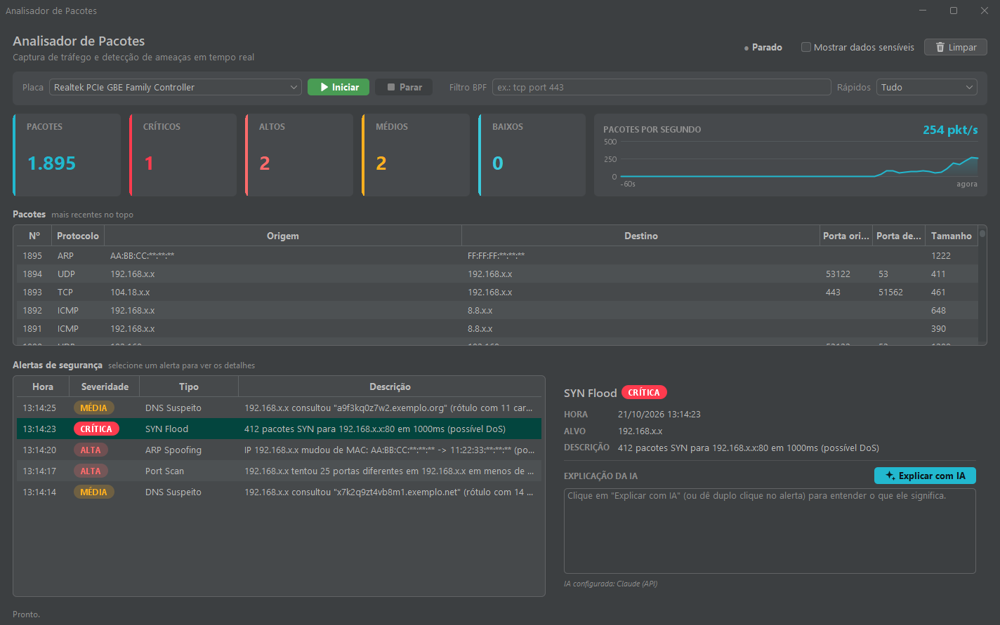

# Analisador de Pacotes



<sub>Print com dados fictícios (IPs de exemplo, já mascarados).</sub>

Aplicação Java com **interface gráfica (Swing)** — e também utilizável via terminal — que captura tráfego de rede (ou lê um arquivo `.pcap`) e alerta em tempo real sobre ameaças:

| Regra | Severidade | O que detecta |
|---|---|---|
| Port Scan | ALTA | 20+ portas distintas com SYN do mesmo IP em 10s |
| SYN Flood | CRÍTICA | 200+ SYN para o mesmo IP:porta em 1s |
| ARP Spoofing | ALTA | Mesmo IP anunciado por um MAC diferente (possível man-in-the-middle) |
| DNS Suspeito | MÉDIA | Subdomínios longos ou de aparência aleatória (DNS tunneling / DGA) |

IPs e MACs aparecem mascarados nos alertas e na lista de pacotes (ex.: `192.168.x.x`, `AA:BB:CC:**:**:**`), a menos que se marque "Mostrar dados sensíveis" na GUI ou se use `--sem-mascara` no terminal.

## Requisitos

- Java 17+ (ex.: `C:\Users\PMSL\.jdks\ms-21.0.11`)
- [Npcap](https://npcap.com) instalado
- Executar **como administrador** para captura ao vivo

## Compilar e testar

```
mvn package
```

Gera `target/analisador-de-pacotes-1.0.0.jar` (já com todas as dependências). A classe principal do jar é a interface gráfica (`br.com.analisador.gui.JanelaPrincipal`).

Para rodar só os testes automatizados (não dependem de captura real nem de administrador):

```
mvn test
```

## Interface gráfica

Clique duas vezes em `target/analisador-de-pacotes-1.0.0.jar` (ou `java -jar target/analisador-de-pacotes-1.0.0.jar`) para abrir a janela principal. No Windows, o `Abrir Analisador.bat` já abre como administrador com o JDK 17. O visual é um painel escuro no estilo das ferramentas de SOC ([FlatLaf](https://www.formdev.com/flatlaf/), destaque ciano):

- **Cabeçalho**: estado da captura (● Parado / Capturando), **Mostrar dados sensíveis** (desmarcado por padrão: IPs/MACs mascarados) e **Limpar** (zera tabelas, contadores e gráfico).
- **Barra de captura**: escolha da **placa** de rede (a física já vem selecionada), **Iniciar** / **Parar**, **filtro BPF** opcional (ex.: `tcp or arp or udp port 53`) e filtros rápidos.
- **Cartões de métricas**: total de pacotes e alertas por severidade (críticos, altos, médios e baixos), com números grandes.
- **Pacotes por segundo**: gráfico em tempo real do último minuto.
- Tabela **Pacotes**: cada pacote capturado, numerado e separado em colunas (protocolo, origem, destino, portas, tamanho), mais recentes no topo.
- Tabela **Alertas de segurança**: alertas das 4 regras acima, com um **selo colorido** de severidade (crítica e alta em vermelho, média em âmbar, baixa em ciano).
- **Painel de detalhes** (à direita dos alertas): ao selecionar um alerta, mostra os dados completos e a **explicação da IA** ali mesmo.
- A janela redimensiona bem (mínimo de 1080x680); as divisórias entre as áreas podem ser arrastadas.

Tudo que vem da rede é exibido como texto puro: as tabelas e o painel de detalhes não interpretam HTML.

## IA integrada: "Explicar com IA"

Na tabela **Alertas de segurança**, selecione um alerta e clique em **Explicar com IA** no painel de detalhes (ou dê duplo clique no alerta). Uma IA (API do Claude ou, se preferir, uma [IA local offline](#ia-local-offline)) explica em português, em quatro partes: **o que significa**, **por que importa**, **pode ser falso positivo?** e **o que fazer**. A chamada roda em segundo plano, então a captura não trava, e respostas já recebidas ficam em cache (selecionar de novo um alerta já explicado mostra a resposta na hora, sem gastar a API).

### Configuração

Crie uma chave em [console.anthropic.com](https://console.anthropic.com) e defina a variável de ambiente antes de abrir o programa:

```
setx ANTHROPIC_API_KEY "sua-chave"      :: Windows (reabra o programa depois)
export ANTHROPIC_API_KEY="sua-chave"    # Linux/macOS
```

Opcional: `ANALISADOR_MODELO` troca o modelo (padrão: `claude-haiku-4-5`, rápido e barato). A chave **nunca** fica no código nem em arquivo do projeto; sem ela, o botão apenas mostra como configurar.

### Privacidade e segurança

- **IPs e MACs nunca saem completos.** Antes de qualquer envio, o texto passa por uma anonimização própria (`192.168.1.50` → `192.168.x.x`, `AA:BB:CC:11:22:33` → `AA:BB:CC:**:**:**`), mesmo com "Mostrar dados sensíveis" ligado.
- Só o **texto do alerta** é enviado (tipo, severidade, alvo mascarado e descrição). Pacotes brutos e conteúdo de tráfego não são enviados. Em alertas de DNS, o nome de domínio consultado faz parte da descrição e é enviado.
- A primeira consulta de cada sessão pede confirmação antes de enviar (no modo local não há envio para a internet, então não há confirmação).
- **Defesa contra prompt injection:** o conteúdo do alerta vem da rede (um nome de DNS, por exemplo, é controlado por quem ataca). Ele é enviado dentro de uma tag de dados, com os sinais `<` `>` removidos e tamanho limitado, e a IA é instruída a nunca obedecer instruções que apareçam ali. A resposta é exibida como texto puro.
- A explicação é um **apoio ao estudo**, não um veredito: confirme sempre antes de agir.

### IA local (offline)

Quer explicações sem chave, sem custo e sem que nada saia do computador? Use o [Ollama](https://ollama.com), que roda modelos de linguagem na sua própria máquina.

1. Instale o Ollama: baixe em [ollama.com/download](https://ollama.com/download) (Windows/macOS) ou, no Linux, `curl -fsSL https://ollama.com/install.sh | sh`.
2. Baixe o modelo (uma vez, cerca de 2 GB):
   ```
   ollama pull llama3.2
   ```
3. Deixe o Ollama rodando: no Windows/macOS basta o aplicativo aberto (ícone perto do relógio); no terminal, `ollama serve`.
4. Ative o modo local e reabra o programa:
   ```
   setx ANALISADOR_IA local                 :: Windows
   export ANALISADOR_IA=local               # Linux/macOS
   ```

| Variável | Valores | Padrão |
|---|---|---|
| `ANALISADOR_IA` | `local` usa o Ollama; qualquer outro valor (ou ausente) usa o Claude | Claude |
| `OLLAMA_MODELO` | qualquer modelo baixado com `ollama pull` (ex.: `llama3.2:1b`, `qwen2.5:3b`) | `llama3.2` |

O programa fala só com `http://localhost:11434`. Se o Ollama não estiver rodando ou o modelo não estiver baixado, o painel de detalhes diz exatamente o que fazer. O rodapé da explicação mostra quem respondeu: **Claude (API)** ou **IA local (Ollama)**. As regras de segurança acima valem igual para os dois (anonimização de IP/MAC, alerta tratado como dado, resposta em texto puro).

| | Claude (API) | IA local (Ollama) |
|---|---|---|
| **Qualidade** | Alta: explicações mais precisas e bem escritas em português | Boa para o básico; modelos pequenos erram mais e podem fugir do formato |
| **Custo** | Pago por uso (frações de centavo por alerta; respostas ficam em cache) | Grátis |
| **Privacidade** | Texto do alerta (já anonimizado) vai para a Anthropic | Nada sai do computador |
| **Precisa de internet?** | Sim | Não (só para instalar e baixar o modelo) |
| **Requisitos** | Chave `ANTHROPIC_API_KEY` | Ollama instalado e ~2 GB de disco; mais lento em PCs sem GPU |

Código: pacote `br.com.analisador.ia` (`ClienteClaude`, `ClienteOllama`, `ProvedorIA`, `AnonimizadorParaIA`, `ExplicadorDeAlertas`). Os testes da camada de IA não usam rede nem chave.

## Terminal

```
set JAR=target/analisador-de-pacotes-1.0.0.jar
java -cp %JAR% br.com.analisador.AnalisadorDePacotes -l              # lista interfaces
java -cp %JAR% br.com.analisador.AnalisadorDePacotes                 # captura na placa física padrão
java -cp %JAR% br.com.analisador.AnalisadorDePacotes -i 4            # captura na interface 4
java -cp %JAR% br.com.analisador.AnalisadorDePacotes -r captura.pcap # analisa um arquivo
java -cp %JAR% br.com.analisador.AnalisadorDePacotes -f "tcp or arp or udp port 53"
java -cp %JAR% br.com.analisador.AnalisadorDePacotes --sem-mascara    # mostra IPs/MACs reais
java -cp %JAR% br.com.analisador.AnalisadorDePacotes --sem-cores      # desativa cores no terminal
java -cp %JAR% br.com.analisador.AnalisadorDePacotes -h               # mostra a ajuda
```

Ctrl+C encerra a captura e mostra o resumo dos alertas.

## Nova regra

Implemente `br.com.analisador.detector.RegraDeteccao` e registre com `detector.adicionarRegra(...)`.
